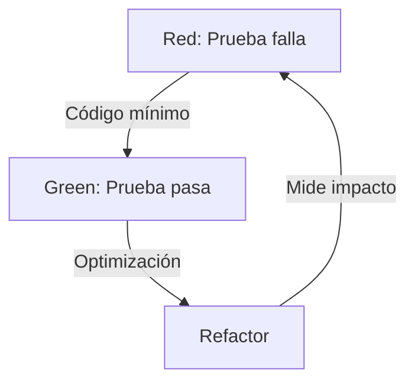

# Cobertura de Pruebas de Software

### Pruebas de Software & TDD

  Grupo 4

<!--
Notas del orador:
Introducción al tema de cobertura de pruebas y su rol fundamental en TDD.
-->

---

# Tabla de Contenido

<Toc text-sm minDepth="1" maxDepth="2" />

---
layout: section
background: https://cover.sli.dev
---

# Concepto e Importancia de la Cobertura en TDD

---
layout: two-cols
gap: 4
---

## Concepto

La **cobertura de pruebas** (*test coverage*) es una métrica cuantitativa que indica el porcentaje del código fuente ejecutado durante las pruebas automatizadas.

En **TDD (Test-Driven Development)**, donde las pruebas se escriben antes del código de producción, sirve para medir qué tanto interactúa la suite de pruebas con el sistema.

::right::

### Ciclo TDD y Cobertura

---

## Importancia en TDD

### Validación Ciclo TDD

Garantiza que el código escrito para pasar de **Red** a **Green** esté efectivamente probado.

### Detección de Código Muerto

Identifica bloques, métodos o condicionales inalcanzables o nunca ejecutados.

### Confianza al Refactorizar

Permite reestructurar código con la certeza de que cualquier ruptura será detectada.

### Prevención de Regresiones

Asegura que cambios futuros no rompan funcionalidades preexistentes.

---

# Tipos de Cobertura

Existen diferentes métricas para medir la cobertura según el nivel de rigor requerido:

| Métrica | Definición | Rigor |
| --- | --- | --- |
| **Líneas / Instrucciones** *(Line/Statement)* | Porcentaje de líneas de código ejecutable recorridas al menos una vez. | Básico |
| **Métodos / Funciones** *(Method Coverage)* | Porcentaje de métodos o funciones invocados al menos una vez. | Medio |
| **Ramas / Decisiones** *(Branch Coverage)* | Porcentaje de rutas lógicas evaluadas (evalúa casos `true` y `false` de condicionales). | Estricto |

---

# Herramientas para medir Cobertura

Herramientas comunes según el ecosistema tecnológico:

* **Java:** `JaCoCo` (Integrado con Maven / Gradle)
* **Python:** `pytest-cov`, `coverage.py`
* **.NET / C#:** `Coverlet`
* **Go:** `go test -cover` (Nativo)

* **Rust:** `cargo-llvm-cov`, `tarpaulin`
* **JavaScript / TypeScript:** `Istanbul`, `Jest`, `Vitest`
* **C / C++:** `gcov`, `lcov`

**Reportes e Informes:** Estas herramientas generan salidas visuales (HTML, XML, LCOV) detallando porcentajes globales, por paquete, clase y líneas no cubiertas.

---

# Interpretación de Informes y Limitaciones

### Interpretación del Informe

* **Código de Colores:**
* Verde: Totalmente cubierto.
* Amarillo: Cobertura parcial de ramas.
* Rojo: Líneas sin ejecutar.

* **Navegación:** Permite inspeccionar desde nivel global hasta la línea exacta sin ejecutar.

### Limitaciones Principales

1. **No mide la calidad de aserciones:** Una línea ejecutada no garantiza que los resultados sean validados correctamente.
2. **Omite casos límite (*Edge Cases*):** No asegura pruebas con datos extremos, nulos o inválidos.
3. **Cantidad vs. Calidad:** Puede fomentar pruebas superficiales solo para aumentar el porcentaje.

---

# ¿Por qué 100% de Cobertura no garantiza 0 Errores?

1. **Ejecución ≠ Corrección:** Que una línea se ejecute no implica que su comportamiento sea el correcto.
2. **Combinatoria de Entradas y Estado:** La cobertura no contempla todas las posibles permutaciones de estado, concurrencia o datos de entrada.
3. **Errores de Especificación:** Si el requisito o la prueba inicial están mal planteados, el código cubrirá una lógica errónea al 100%.
---

# Conclusión:

La cobertura es una métrica de **diagnóstico de puntos ciegos**, no una garantía absoluta de ausencia de fallos.

 
 
 

> Las pruebas de programas pueden ser una forma muy eficaz de demostrar la presencia de errores, pero resultan totalmente insuficientes para demostrar su ausencia.
- Edsger Dijkstra. *the humble programmer* (1972)

---
layout: end
class: text-center
---

# ¿Preguntas o Comentarios?

Gracias por su atención.
